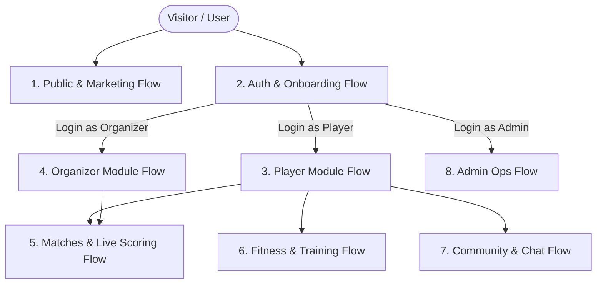

# SportSphere: Complete Application Pages Directory & User Flows

This document contains the complete page directory and interactive flow map for **SportSphere**. All links are directly accessible while the frontend is running at **[http://localhost:3000](http://localhost:3000)** and backend at **[http://localhost:5000](http://localhost:5000)**.

---

## 🔑 Test Accounts & Credentials

| Role | Email | Password | Primary Data & Event |
|---|---|---|---|
| **Organizer** | `cham_organizer@sportsphere.com` | `Password123!` | Manages **CHAM KINGS** Cricket Knockout |
| **Player** | `cham_player@sportsphere.com` | `Password123!` | Captain of **CHAM Strikers** |
| **Admin** | `admin@sportsphere.com` | `Admin123!` | Full platform administration |

---

## 🗺️ Master Flow Architecture



---

## 1. Authentication & Onboarding Flow

| Page Name | Direct URL Link | Component Source File | Description |
|---|---|---|---|
| **Login** | [http://localhost:3000/login](http://localhost:3000/login) | `client/src/pages/Auth/LoginPage.js` | User login screen with JWT authentication |
| **Register** | [http://localhost:3000/register](http://localhost:3000/register) | `client/src/pages/Auth/RegisterPage.js` | Account creation with role selection (`player` / `organizer`) |
| **Email Verification** | [http://localhost:3000/verify-email/sample-token](http://localhost:3000/verify-email/sample-token) | `client/src/pages/Auth/VerifyEmail.js` | Token verification confirmation |
| **OAuth Callback** | [http://localhost:3000/auth/google/callback](http://localhost:3000/auth/google/callback) | `client/src/pages/Auth/GoogleCallback.js` | Google OAuth token parser and redirector |

---

## 2. Player Module Flow (Athlete & Squads)

The athlete journey from managing their athletic identity to creating teams and registering for tournaments.

```
[ Dashboard ] ──► [ My Registrations ] ──► [ My Teams ] ──► [ Discover Tournaments ] ──► [ Register Team ]
```

| Page Name | Direct URL Link | Component Source File | Description |
|---|---|---|---|
| **Player Dashboard** | [http://localhost:3000/dashboard](http://localhost:3000/dashboard) | `client/src/pages/Dashboard.js` | Central athlete overview: upcoming matches, registered tournaments & fitness metrics |
| **My Registrations** | [http://localhost:3000/dashboard/registrations](http://localhost:3000/dashboard/registrations) | `client/src/pages/Dashboard/MyRegistrations.js` | Real-time status tracking (`Pending`, `Approved`, `Rejected`) |
| **Athlete Profile** | [http://localhost:3000/profile](http://localhost:3000/profile) | `client/src/pages/Profile/ProfilePage.js` | Manage bio, primary sport, jersey number, and position |
| **Account Settings** | [http://localhost:3000/settings](http://localhost:3000/settings) | `client/src/pages/Settings/SettingsPage.js` | User preferences, notifications, and security controls |
| **Teams Hub** | [http://localhost:3000/teams](http://localhost:3000/teams) | `client/src/pages/Team/TeamsPage.js` | Browse all registered clubs and sports squads |
| **Create Team** | [http://localhost:3000/teams/create](http://localhost:3000/teams/create) | `client/src/pages/Team/TeamCreatePage.js` | Form to create a new squad and assign captaincy |
| **Team Details & Roster** | [http://localhost:3000/teams/6ae6278cb139f117c38ccb0f](http://localhost:3000/teams/6ae6278cb139f117c38ccb0f) | `client/src/pages/Team/TeamDetails.js` | View squad roster, player stats, and match history |
| **Team Chat Room** | [http://localhost:3000/teams/6ae6278cb139f117c38ccb0f/chat](http://localhost:3000/teams/6ae6278cb139f117c38ccb0f/chat) | `client/src/pages/Team/TeamChat.js` | Squad-only private real-time strategy chat |

---

## 3. Organizer Module Flow (Tournament & Event Ops)

The complete tournament management workflow for organizers.

```
[ Create Tournament ] ──► [ Command Center ] ──► [ Approve Teams ] ──► [ Generate Bracket ] ──► [ Broadcast Alerts ]
```

| Page Name | Direct URL Link | Component Source File | Description |
|---|---|---|---|
| **Organizer Dashboard** | [http://localhost:3000/dashboard](http://localhost:3000/dashboard) | `client/src/pages/Dashboard.js` | Organizer KPI board showing active events and pending registrations |
| **Tournaments Directory** | [http://localhost:3000/tournaments](http://localhost:3000/tournaments) | `client/src/pages/Tournament/TournamentHub.js` | Public tournament exploration hub with sport and location filters |
| **Create Tournament** | [http://localhost:3000/tournaments/create](http://localhost:3000/tournaments/create) | `client/src/pages/Tournament/TournamentCreatePage.js` | Wizard for Single/Double Elimination and Round Robin events |
| **Tournament Public Page** | [http://localhost:3000/tournaments/6ae627cd37ec476b92abe84b](http://localhost:3000/tournaments/6ae627cd37ec476b92abe84b) | `client/src/pages/Tournament/TournamentDetails.js` | Public event view of **CHAM KINGS** with rules, venue, and "Register Team" CTA |
| **Organizer Command Center** | [http://localhost:3000/tournaments/6ae627cd37ec476b92abe84b/dashboard](http://localhost:3000/tournaments/6ae627cd37ec476b92abe84b/dashboard) | `client/src/pages/Tournament/TournamentDashboard.js` | Central control center for managing the tournament |
| **Participant Approvals** | [http://localhost:3000/tournaments/6ae627cd37ec476b92abe84b/participants](http://localhost:3000/tournaments/6ae627cd37ec476b92abe84b/participants) | `client/src/pages/Tournament/ParticipantManagement.js` | Review squads, click **Approve** or **Reject** with real-time socket push |
| **Bracket Generator** | [http://localhost:3000/tournaments/6ae627cd37ec476b92abe84b/brackets](http://localhost:3000/tournaments/6ae627cd37ec476b92abe84b/brackets) | `client/src/pages/Tournament/TournamentBracket.js` | Interactive bracket visualizer supporting Single and Double Elimination |
| **Communication Center** | [http://localhost:3000/tournaments/6ae627cd37ec476b92abe84b/communication](http://localhost:3000/tournaments/6ae627cd37ec476b92abe84b/communication) | `client/src/pages/Tournament/CommunicationCenter.js` | Broadcast announcements via WebSocket alerts and automated emails |
| **Financial Reports** | [http://localhost:3000/tournaments/6ae627cd37ec476b92abe84b/financials](http://localhost:3000/tournaments/6ae627cd37ec476b92abe84b/financials) | `client/src/pages/Tournament/FinancialReports.js` | Entry fee revenue, payout allocation, and net financial tracking |
| **Live Spectator Board** | [http://localhost:3000/tournaments/6ae627cd37ec476b92abe84b/live](http://localhost:3000/tournaments/6ae627cd37ec476b92abe84b/live) | `client/src/pages/Tournament/LiveTournamentBoard.js` | Real-time spectator view of tournament standings and live fixtures |
| **Tournament Score Entry** | [http://localhost:3000/tournaments/6ae627cd37ec476b92abe84b/scoring](http://localhost:3000/tournaments/6ae627cd37ec476b92abe84b/scoring) | `client/src/pages/Tournament/ScoreEntry.js` | Quick score entry console for all tournament fixtures |

---

## 4. Matches & Real-Time Multi-Sport Scoring Flow

Real-time WebSocket scoreboards, sport scoring consoles, and social graphic generators.

```
[ Matches Hub ] ──► [ Match Details & Story Card ] ──► [ Live Scoring Consoles (4 Sports) ]
```

| Page Name | Direct URL Link | Component Source File | Description |
|---|---|---|---|
| **Matches Hub** | [http://localhost:3000/matches](http://localhost:3000/matches) | `client/src/pages/Matches/MatchesHub.js` | Live scorecards and scheduled fixtures with skeleton loaders |
| **Create Match / Fixture** | [http://localhost:3000/matches/create](http://localhost:3000/matches/create) | `client/src/pages/Matches/CreateMatch.js` | Schedule standalone or tournament fixtures |
| **Match Details & Story Card** | [http://localhost:3000/matches/6ae60e97ace3b2731dd5e389](http://localhost:3000/matches/6ae60e97ace3b2731dd5e389) | `client/src/pages/Matches/MatchDetails.js` | Real-time score viewer with **1-Click "Story Card"** generator modal |
| **Cricket Scoring Console** | [http://localhost:3000/matches/score/cricket/6ae60e97ace3b2731dd5e389](http://localhost:3000/matches/score/cricket/6ae60e97ace3b2731dd5e389) | `client/src/pages/Matches/Scoring/CricketScoring.js` | Ball-by-ball console: runs, wickets, extras, boundaries, overs |
| **Badminton Scoring Console** | [http://localhost:3000/matches/score/badminton/6ae60e97ace3b2731dd5e389](http://localhost:3000/matches/score/badminton/6ae60e97ace3b2731dd5e389) | `client/src/pages/Matches/Scoring/BadmintonScoring.js` | Point-by-point sets, deuce handling, and game points |
| **Volleyball Scoring Console** | [http://localhost:3000/matches/score/volleyball/6ae60e97ace3b2731dd5e389](http://localhost:3000/matches/score/volleyball/6ae60e97ace3b2731dd5e389) | `client/src/pages/Matches/Scoring/VolleyballScoring.js` | Set points, timeouts, player rotations, and match results |
| **Kabaddi Scoring Console** | [http://localhost:3000/matches/score/kabaddi/6ae60e97ace3b2731dd5e389](http://localhost:3000/matches/score/kabaddi/6ae60e97ace3b2731dd5e389) | `client/src/pages/Matches/Scoring/KabaddiScoring.js` | Raid points, bonus points, tackle points, and all-out tracker |
| **Cricket Dedicated Hub** | [http://localhost:3000/cricket](http://localhost:3000/cricket) | `client/src/pages/Cricket/CricketHub.js` | Specialized cricket matches, series, and local tournaments |

---

## 5. Fitness & Training Flow

Conditioning catalog, interactive timers, and volume tracking for athletes.

| Page Name | Direct URL Link | Component Source File | Description |
|---|---|---|---|
| **Fitness Hub** | [http://localhost:3000/fitness](http://localhost:3000/fitness) | `client/src/pages/Fitness/FitnessHub.js` | Athlete conditioning overview, workout streaks & calorie log |
| **Browse Workouts** | [http://localhost:3000/fitness/browse-workouts](http://localhost:3000/fitness/browse-workouts) | `client/src/pages/Fitness/BrowseWorkout.js` | Sports-specific drill catalog with shimmer skeleton screens |
| **Workout Builder** | [http://localhost:3000/fitness/workout-builder](http://localhost:3000/fitness/workout-builder) | `client/src/pages/Fitness/WorkoutBuilder.js` | Custom drill creator and sequence builder |
| **Interactive Workout Timer** | [http://localhost:3000/fitness/timer](http://localhost:3000/fitness/timer) | `client/src/pages/Fitness/WorkoutTimer.js` | Fullscreen HIIT / Tabata / interval training timer with audio cues |
| **Progress & Volume Tracker** | [http://localhost:3000/fitness/progress](http://localhost:3000/fitness/progress) | `client/src/pages/Fitness/ProgressTracker.js` | Visual training charts, calories burned, and monthly exercise volume |
| **Nutrition Tracker** | [http://localhost:3000/fitness/nutrition](http://localhost:3000/fitness/nutrition) | `client/src/pages/Fitness/NutritionTracker.js` | Calorie and macronutrient intake log |
| **Nutrition Guide** | [http://localhost:3000/fitness/nutrition-guide](http://localhost:3000/fitness/nutrition-guide) | `client/src/pages/Fitness/NutritionGuide.js` | Athlete hydration and pre-game nutrition guides |

---

## 6. Community, Chat & Social Flow

| Page Name | Direct URL Link | Component Source File | Description |
|---|---|---|---|
| **Community Posts & Highlights** | [http://localhost:3000/posts](http://localhost:3000/posts) | `client/src/pages/Posts/PostsHub.js` | Social feed for photos, video clips, and match highlights |
| **Direct & Group Messages** | [http://localhost:3000/chat](http://localhost:3000/chat) | `client/src/pages/Chat/ChatHub.js` | Real-time direct messaging between players and teams |

---

## 7. Platform Administration Flow

Accessible when authenticated with `role: 'admin'`.

| Page Name | Direct URL Link | Component Source File | Description |
|---|---|---|---|
| **Admin Overview** | [http://localhost:3000/admin](http://localhost:3000/admin) | `client/src/pages/Admin/AdminDashboard.js` | Global platform telemetry and system health |
| **User Management** | [http://localhost:3000/admin/users](http://localhost:3000/admin/users) | `client/src/pages/Admin/UserManagement.js` | Manage user accounts, role escalations, and suspensions |
| **Tournament Verification** | [http://localhost:3000/admin/verification](http://localhost:3000/admin/verification) | `client/src/pages/Admin/TournamentVerification.js` | Approve official tournaments and verify organizers |
| **Content Moderation** | [http://localhost:3000/admin/moderation](http://localhost:3000/admin/moderation) | `client/src/pages/Admin/ContentModeration.js` | Moderate reported posts, comments, and media |
| **Platform Analytics** | [http://localhost:3000/admin/analytics](http://localhost:3000/admin/analytics) | `client/src/pages/Admin/GlobalAnalytics.js` | User growth, match velocity, and engagement data |
| **System Settings** | [http://localhost:3000/admin/settings](http://localhost:3000/admin/settings) | `client/src/pages/Admin/PlatformSettings.js` | Maintenance flags, SMTP configuration, and security rules |

---

## 8. Public Information & Support Flow

| Page Name | Direct URL Link | Component Source File | Description |
|---|---|---|---|
| **Landing Page** | [http://localhost:3000/](http://localhost:3000/) | `client/src/pages/LandingPage.js` | Showcase of features, live scores, and trending events |
| **About SportSphere** | [http://localhost:3000/about](http://localhost:3000/about) | `client/src/pages/AboutPage.js` | Mission statement and platform story |
| **Help & Support** | [http://localhost:3000/help](http://localhost:3000/help) | `client/src/pages/HelpPage.js` | FAQs and user guides |
| **Contact Us** | [http://localhost:3000/contact](http://localhost:3000/contact) | `client/src/pages/ContactPage.js` | Contact inquiry form with email routing |
| **Privacy Policy** | [http://localhost:3000/privacy](http://localhost:3000/privacy) | `client/src/pages/PrivacyPage.js` | Data collection and privacy terms |
| **Terms of Service** | [http://localhost:3000/terms](http://localhost:3000/terms) | `client/src/pages/TermsPage.js` | Platform usage guidelines and code of conduct |
